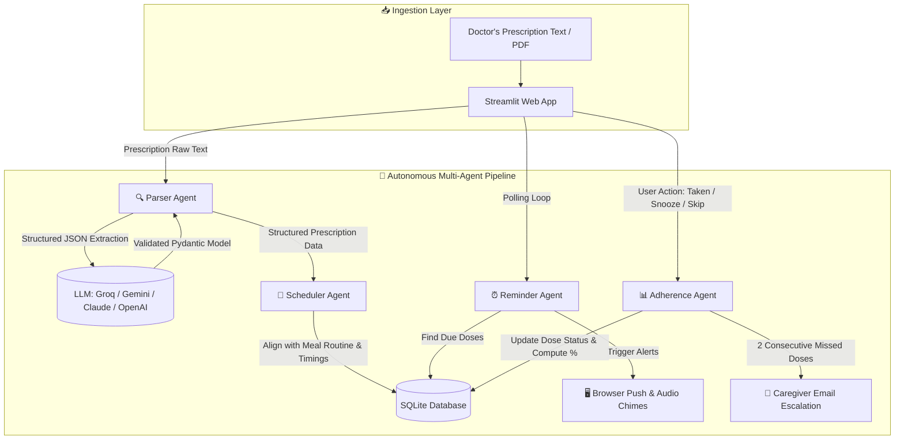

# 💊 MedMinder AI: Multi-Agent Medicine Reminder & Adherence System

[](https://www.python.org/)
[](https://streamlit.io/)
[](https://github.com/Yashkhadgi/medicine-reminder-agent)
[](https://github.com/Yashkhadgi/medicine-reminder-agent)
[](https://opensource.org/licenses/MIT)

**MedMinder AI** is an intelligent, agentic healthcare assistant designed to eliminate medication non-adherence. Powered by a collaborative team of four autonomous AI agents, it extracts prescription details from text or uploaded PDFs, schedules personalized doses aligned with daily meal routines, fires real-time browser desktop push notifications with audio alerts, tracks patient adherence, and escalates to caregivers if doses are repeatedly missed.

> ⚠️ **Disclaimer:** *MedMinder AI is a personal medication management assistant and reminder tool. It does not provide medical diagnosis or advice. Always follow your licensed healthcare provider's instructions.*

---

## 🌟 Key Features

- 🤖 **Collaborative 4-Agent Pipeline**: Specialized autonomous agents handle parsing, intelligent scheduling, active reminder delivery, and adherence tracking.
- 📄 **Prescription Ingestion**: Accepts raw prescription text or uploaded PDF documents (using PyMuPDF) to extract medication names, dosages, frequencies, food relations, and durations.
- 🧠 **Multi-Provider LLM Engine**: Seamlessly switch between **Groq** (ultra-fast inference), **Google Gemini**, **Anthropic Claude**, and **OpenAI**. Includes an offline regex fallback parser when no API key is present.
- 🔔 **Multi-Channel Reminders**:
  - 🖥️ **Browser Desktop Push Notifications** (system banner alerts even when minimized)
  - 🔊 **HTML5 Audio Chimes** for audible dose alerts
  - 📧 **Caregiver Escalation via SMTP Email** (triggered automatically after 2 consecutive missed doses)
- 🍽️ **Meal-Aware Dose Scheduling**: Automatically schedules medication around personalized breakfast, lunch, dinner, and bedtime slots with before/after food timing offsets.
- 📊 **Adherence Analytics**: Interactive charts, dose response history (Taken, Snoozed, Skipped, Missed), and a full agent activity audit log.
- 🧪 **Speedy Demo Mode**: Experience full reminder, snooze, miss, and caregiver escalation lifecycles in 30–60 seconds for testing and demonstrations.

---

## 🏗️ Multi-Agent Architecture



### The 4 Agents & Their Roles

| Agent | Module | Responsibility |
| :--- | :--- | :--- |
| **🔍 Parser Agent** | `agents/parser_agent.py` | Extracts structured medication models (`Medicine`, `Prescription`) from unformatted prescription text or PDFs via LLM JSON mode with schema validation and offline fallback. |
| **📅 Scheduler Agent** | `agents/scheduler_agent.py` | Maps medication slots (`breakfast`, `lunch`, `dinner`, `bedtime`) and food constraints (`before`, `after`, `with`) to specific calendar timestamps based on user profile settings. |
| **⏰ Reminder Agent** | `agents/reminder_agent.py` | Scans pending doses, detects when doses become due, triggers desktop push banners and audio chimes, and handles snooze windows. |
| **📊 Adherence Agent** | `agents/adherence_agent.py` | Tracks dose statuses, identifies unacknowledged doses as **missed**, calculates adherence metrics, and automatically dispatches escalation emails to caregivers when 2 consecutive doses are missed. |

---

## 🚀 Quick Start

### 1. Clone the Repository

```bash
git clone https://github.com/Yashkhadgi/medicine-reminder-agent.git
cd medicine-reminder-agent
```

### 2. Create and Activate Virtual Environment

```bash
# macOS / Linux
python3 -m venv .venv
source .venv/bin/activate

# Windows (Command Prompt)
python -m venv .venv
.venv\Scripts\activate.bat

# Windows (PowerShell)
python -m venv .venv
.venv\Scripts\Activate.ps1
```

### 3. Install Dependencies

```bash
pip install -r requirements.txt
```

### 4. Configure Environment Variables

Copy the example environment configuration file:

```bash
cp .env.example .env
```

Edit `.env` and add your preferred LLM API key (Groq, Gemini, Anthropic, or OpenAI):

```env
# Choose provider: groq | gemini | anthropic | openai
LLM_PROVIDER=groq
GROQ_API_KEY=gsk_your_groq_api_key_here
GROQ_MODEL=openai/gpt-oss-20b

# Optional: Email & Caregiver Alerts (Gmail App Password)
SMTP_HOST=smtp.gmail.com
SMTP_PORT=587
SMTP_USER=your_email@gmail.com
SMTP_PASSWORD=your_gmail_app_password
```

*(Note: If no API key is provided, MedMinder AI automatically falls back to its built-in rule-based offline parser).*

### 5. Launch the Application

```bash
streamlit run app.py
```

The application will open in your browser at `http://localhost:8501`.

---

## 🎬 60-Second Demo Walkthrough

1. Open the sidebar and toggle **⚡ Demo mode (fast-forward)**.
2. In **Add Prescription**, select a sample prescription (e.g., *Amoxicillin + Cetirizine*) or upload a PDF.
3. Click **🤖 Parse with AI Agent**, review the structured table, and click **Confirm & Schedule Doses**.
4. Within ~30 seconds, a red **Due Dose Card** will appear with an audio chime and desktop push alert.
5. Click **Taken** on the first dose, and **Snooze** on the second (it returns in 15 seconds).
6. Let a subsequent dose expire without responding—the **Adherence Agent** marks it **Missed**.
7. After two consecutive missed doses, observe the **🚨 Caregiver Escalation Alert** generated in the **Agent Activity** tab!

---

## ⚙️ Configuration & Environment

| Variable | Description | Default |
| :--- | :--- | :--- |
| `LLM_PROVIDER` | Selected LLM backend (`groq`, `gemini`, `anthropic`, `openai`) | `groq` |
| `GROQ_API_KEY` | API Key for Groq Cloud | `""` |
| `GROQ_MODEL` | Groq Model Identifier | `openai/gpt-oss-20b` |
| `GEMINI_API_KEY` | Google Gemini API Key | `""` |
| `ANTHROPIC_API_KEY`| Anthropic Claude API Key | `""` |
| `OPENAI_API_KEY` | OpenAI API Key | `""` |
| `SMTP_HOST` | SMTP server for email reminders | `smtp.gmail.com` |
| `SMTP_PORT` | SMTP server port | `587` |
| `SMTP_USER` | SMTP username / email address | `""` |
| `SMTP_PASSWORD` | SMTP app password | `""` |

---

## 🧪 Testing

Run the test suite covering parsing, scheduling, adherence tracking, and agent fallbacks:

```bash
pip install -r requirements-dev.txt
pytest -v
```

---

## 📁 Repository Structure

```
medicine-reminder-agent/
├── agents/
│   ├── __init__.py
│   ├── adherence_agent.py     # Missed dose detection, adherence calculation & caregiver escalation
│   ├── parser_agent.py        # LLM JSON parsing, validation & regex fallback
│   ├── reminder_agent.py      # Due dose discovery & push notification dispatch
│   └── scheduler_agent.py     # Meal-based schedule generation & time calculation
├── docs/
│   └── architecture.md        # Detailed architecture and sequence diagrams
├── tests/
│   ├── __init__.py
│   └── test_core.py           # Unit tests for agents, parser, database & rules
├── .env.example               # Template environment configuration
├── .gitignore                 # Excluded files (database, secrets, virtualenvs)
├── app.py                     # Streamlit web UI & real-time agent orchestrator
├── config.py                  # Global application settings & timezone defaults
├── db.py                      # SQLite database schema and ORM methods
├── llm.py                     # Multi-provider LLM connector (Groq, Gemini, Claude, OpenAI)
├── models.py                  # Pydantic schemas for prescriptions & doses
├── notifier.py                # SMTP email notification handler
├── requirements.txt           # Production dependencies
└── sample_prescriptions.txt   # Example prescription texts for testing
```

---

## 🛡️ License

This project is distributed under the [MIT License](LICENSE).
